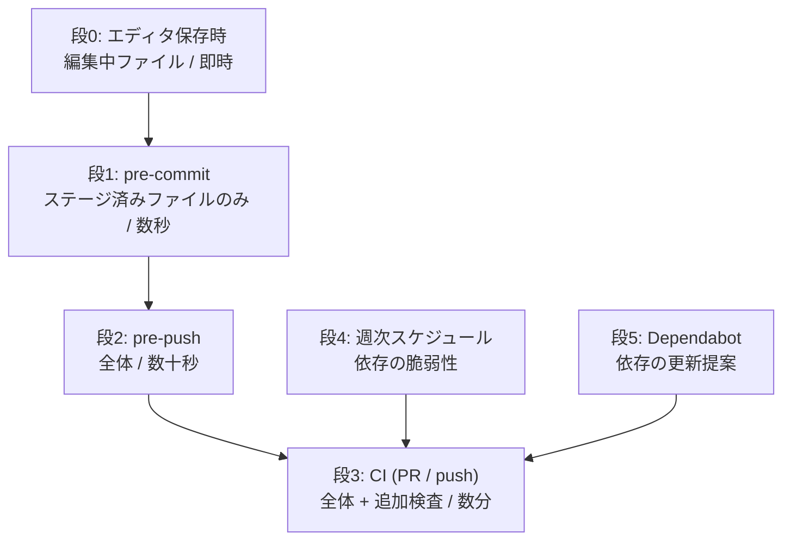
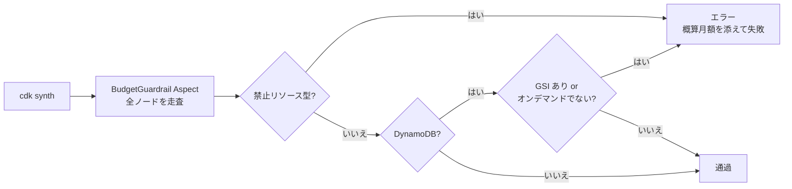

# 設計書: ci-cd（品質ゲートと自動化）

## 1. 設計の中心的な考え方

**規約を「文書」から「実行される検査」へ移す。**

`.kiro/steering/` には多くの規約があるが、現状それを守っているか確認する仕組みがない。
`database` Spec で「SK 直書き禁止」をキービルダーと型で強制したのと同じ手法を、
プロジェクト全体の規約に適用する。

とくに**予算上限（月1,000円）は現在ドキュメント上の約束にすぎない。** NAT Gateway を
1つ定義するだけで上限の5倍を超えるため、これを機械的に防ぐことを本 Spec の主眼に置く。

## 2. 多層防御の段階設計



### 段ごとの責務

| 段 | 検査内容 | 失敗時 |
|---|---|---|
| 0 | 整形、ESLint 自動修正 | 自動修正されるのみ |
| 1 | 変更ファイルの整形・lint・機密情報検査・関連テスト | コミット中断 |
| 2 | 全体の型検査・全テスト・高深刻度の脆弱性 | push 中断 |
| 3 | 段2の全項目 + 履歴の機密情報検査 + IaC 検査 + 予算ガードレール検査 + 全深刻度の脆弱性 | マージ不可 |
| 4 | 依存の脆弱性（コード変更がない期間もカバー） | 通知 |
| 5 | 依存の更新 PR 作成（メジャーは除く） | - |

**設計原則**

- **早い段は軽く、遅い段は重く。** 段1で全体検査を走らせると、コミットのたびに待つことになり
  「毎日面倒なく使える」という本プロジェクトの価値基準に反する
- **検査は意図的に重複させる。** 段1〜2を `--no-verify` で飛ばしても段3で止まる
- **段3は段1〜2の上位集合にする。** ローカルで通ったものが CI で落ちる状況を減らす
- **ローカルにしかない検査を作らない。** CI が最終的な正とする

## 3. ツール選定

| 用途 | ツール | 選定理由 |
|---|---|---|
| lint | ESLint 9（Flat Config）+ typescript-eslint | 型情報を使った検査（`no-floating-promises` 等）が Lambda の非同期コードで効く |
| 整形 | Prettier 3 | 追加の学習コストがない。lollab と同じ |
| 型検査 | TypeScript（既存の `tsc --build`） | 既に導入済み |
| テスト | Vitest（既存） | 既に導入済み |
| 機密情報（ローカル） | **secretlint** | npm パッケージで完結し、外部バイナリの導入が不要。Windows でも動く |
| 機密情報（履歴） | **gitleaks**（GitHub Action） | 履歴を遡って検査できる。CI では Action なのでローカル環境を汚さない |
| IaC セキュリティ | **cdk-nag** | CDK 専用。抑制時に理由の記述を強制する仕組みを持つ |
| 予算ガードレール | **自作の CDK Aspect** | 既存ツールに該当機能がない。詳細は 5 章 |
| 依存脆弱性 | `npm audit` | 追加導入なし |
| 依存更新 | Dependabot | GitHub 標準。追加コストなし |
| git hooks | husky 9 + lint-staged | lollab と同じ。実績がある |

### 機密情報検査に2つのツールを使う理由

secretlint は作業ツリーのファイルを検査するが、**既にコミットされたものは見ない。**
このリポジトリには hooks 導入前のコミットが既に4つあるため、履歴の検査が必要になる。

- ローカル（段1）: secretlint。コミット自体を止める
- CI（段3）: gitleaks。履歴に残ってしまったものを検出する

要件7（設定の二重管理禁止）との関係: 用途が異なるツールであり、それぞれ設定ファイルは
1つずつなので矛盾しない。

### 採用しないもの

| 候補 | 理由 |
|---|---|
| detect-secrets | Python 依存。このプロジェクトに Python を持ち込まない |
| trufflehog | 導入と実行が重い。個人開発の規模に合わない |
| Biome | ESLint / Prettier を置き換える利点が現時点でない。cdk-nag 等との組み合わせ実績も薄い |
| commitlint | コミットメッセージ規約は一人開発では効果が薄い。必要になったら追加する |
| カバレッジ閾値 | 数値を満たすためのテストを書く動機が生まれる。テストの質は別の手段で担保する |

## 4. 設定ファイルの配置

**各ツールの設定はルートに1つだけ置く。** lollab では ESLint 設定が `.mjs` と `.mts` で
二重化しており、どちらが有効か分かりにくい状態になっていた。これを再現しない。

```
lifepilot/
├── .nvmrc                      # Node バージョンの単一の正（CI もこれを参照）
├── eslint.config.js            # ESLint（唯一）
├── .prettierrc                 # Prettier（唯一）
├── .prettierignore
├── .secretlintrc.json          # secretlint
├── .gitleaks.toml              # gitleaks の除外設定
├── package.json                # lint-staged 設定を含む
├── .husky/
│   ├── pre-commit
│   └── pre-push
├── .vscode/
│   └── settings.json           # 段0
├── .github/
│   ├── workflows/ci.yml        # 段3, 段4
│   └── dependabot.yml          # 段5
└── infra/src/aspects/
    └── budget-guardrail.ts     # 予算ガードレール検査
```

**Node バージョンは `.nvmrc` を単一の正とする。** CI は `setup-node` の
`node-version-file` でこれを参照し、値を YAML に転記しない（要件7）。

## 5. 予算ガードレール検査

本 Spec で最も重要な部分。

### 実装方式: CDK Aspect

テストではなく **Aspect** として実装する。理由は**強制のタイミング**にある。

| 方式 | `cdk deploy` を止められるか | CI を止められるか |
|---|---|---|
| Vitest のテストのみ | **止められない** | 止められる |
| CDK Aspect | **止められる**（synth 時に失敗） | 止められる |

テストだけだと、テストを実行せずに `cdk deploy` した場合に素通りする。
Aspect は合成処理の一部なので回避できない。

### 検査内容



**禁止リソース型**（要件2.2）。エラーメッセージに概算月額を含め、
なぜ禁止なのかが分かるようにする。

| リソース型 | 概算月額 |
|---|---|
| `AWS::EC2::NatGateway` | $35〜45 |
| `AWS::ElasticLoadBalancingV2::LoadBalancer` | $18〜 |
| `AWS::ElasticLoadBalancing::LoadBalancer` | $18〜 |
| `AWS::RDS::DBInstance` | $15〜 |
| `AWS::RDS::DBCluster` | $45〜 |
| `AWS::RDS::DBProxy` | $15〜 |
| `AWS::SecretsManager::Secret` | $0.40/件 |
| `AWS::KMS::Key` | $1/件 |

**DynamoDB の追加検査**（要件2.3, 2.4）

- `GlobalSecondaryIndexes` / `LocalSecondaryIndexes` が存在しないこと
- `BillingMode` が `PAY_PER_REQUEST` であること

### 型定義

```typescript
// infra/src/aspects/budget-guardrail.ts

/** 禁止リソースを例外的に許可する設定。理由の記述を必須にする（要件2.5） */
interface GuardrailException {
  readonly resourceType: string;
  /** なぜ予算超過を許容するのかを記述する。空文字は許可しない */
  readonly reason: string;
  /** 見積もっている月額の増加分（USD） */
  readonly estimatedMonthlyUsd: number;
}

interface BudgetGuardrailProps {
  readonly exceptions?: readonly GuardrailException[];
}

class BudgetGuardrail implements IAspect {
  constructor(props?: BudgetGuardrailProps);
  visit(node: IConstruct): void;
}

/** 禁止リソース型と概算月額の対応表 */
declare const FORBIDDEN_RESOURCES: ReadonlyMap<string, string>;
```

Aspect は `infra/src/app.ts` で App 全体に適用する。スタックを追加しても自動で対象になる。

### Aspect 自体のテスト

**Aspect が正しく機能することをテストで検証する。** 検査する仕組み自体が壊れていたら
意味がないため、以下を確認する。

- 禁止リソースを含むテスト用スタックで合成が失敗すること
- 現行の `DataStack` が通過すること
- 例外設定に理由が無い場合は設定自体が拒否されること
- DynamoDB に GSI を足すと失敗すること

## 6. cdk-nag の適用方針

`AwsSolutionsChecks` を App 全体に適用する。

**想定される負荷**: cdk-nag は単純なスタックでも多数の指摘を出す。すべてを解消するのは
現実的でないため、**抑制（suppression）を使う。** cdk-nag は抑制時に `reason` の記述を
要求するため、要件4.3（理由の記述を伴う）は仕組みとして満たされる。

抑制は「なぜこの指摘を受け入れるか」を書く場所として機能させる。
たとえば個人利用のため multi-AZ にしない、といった判断を残す。

**エラーとして扱う指摘の範囲**は実装時に決める。最初から全件エラーにすると着手できないため、
段階的に厳しくする。

## 7. ESLint の設定方針

### 型情報を使った検査を有効にする

`typescript-eslint` の型情報つきルールを使う。理由は `no-floating-promises` が
Lambda / DynamoDB クライアントの非同期処理で実際のバグを捕まえるため。
型情報なしの検査では検出できない。

### プロジェクト固有の境界をルールで強制する

`structure.md` に「フロントエンドは SK を知る必要がないため `packages/backend/keys/` に置く」
と書いたが、現状これは文書上の約束にすぎない。`no-restricted-imports` で
**フロントエンドから `@lifepilot/backend` への import を禁止**し、境界を機械的に守る。

これも「規約を検査に移す」方針の一例。

### 警告を残さない

**`--max-warnings 0` を指定する。** lollab では追加ルールがすべて `warn` かつ
`--max-warnings` 未指定だったため、警告が何件あっても CI が通る状態だった。
警告として放置できる仕組みを作らない。

例外を認める場合は、ルールを `off` にするか、該当箇所に理由付きの
`eslint-disable` コメントを書く。どちらも意図が明示される。

## 8. CI の構成

### ジョブ構成

**1ジョブに集約する。** lollab は frontend / backend の2ジョブだったが、
lifepilot は全体が TypeScript のモノレポなので分割する理由がない。

### ステップ順序

失敗しやすく実行が速いものを先に置き、フィードバックを早める。

1. checkout（**履歴全体を取得** — gitleaks が履歴を検査するため）
2. Node セットアップ（`.nvmrc` 参照 + npm キャッシュ）
3. 依存インストール（`npm ci`）
4. 機密情報検査（履歴 + 作業ツリー）
5. 整形チェック
6. lint（警告も失敗）
7. 型検査
8. テスト
9. `cdk synth`（予算ガードレール Aspect と cdk-nag がここで動く）
10. 依存の脆弱性検査

**9 が重要**: 合成を CI で実行することで、Aspect と cdk-nag の検査が
デプロイ前に必ず1回走る。

### GitHub Actions の設定方針

- **`permissions` を明示して最小権限にする**（`contents: read`）。
  既定のトークン権限は広いため、明示的に絞る
- **`concurrency` で同一 ref の進行中ジョブをキャンセルする**。
  無料枠の実行時間を無駄にしないため
- トリガー: `pull_request`（main, develop）、`push`（main, develop）、週次スケジュール
- **`continue-on-error` を使わない**（要件1, 5）。lollab では audit が
  `continue-on-error: true` で実質ノーゲートだった

### シークレット

**本 Spec では GitHub Secrets を使わない。** デプロイを含まないため AWS 認証情報が不要。
`cdk synth` はアカウント情報なしで動く必要がある（現在の `app.ts` は
`CDK_DEFAULT_ACCOUNT` が未定義でも動く実装になっている）。

## 9. Dependabot の構成

**2エントリにする。** lollab は npm / pip / github-actions の3つだったが、
Python がなく、npm workspaces はルートの lock ファイルを見るためディレクトリ分割も不要。

| エコシステム | ディレクトリ |
|---|---|
| npm | `/` |
| github-actions | `/` |

方針は lollab を踏襲する。

- 週次
- **メジャーバージョン更新は自動提案しない**（破壊的変更を手動で確認する）
- コミットメッセージの接頭辞を付ける

## 10. 既知の課題

### Vitest の環境設定

現在の `vitest.config.ts` は `environment: "node"` 固定、`include` は `*.test.ts` のみで、
`.tsx` を拾わない。フロントエンドのコンポーネントテストには jsdom 環境が必要になる。

**本 Spec では対応しない。** フロントエンドが存在しない段階で環境を用意しても
検証できないため、`auth-login` Spec で実際のコンポーネントとあわせて設定する。

### cdk-nag の指摘の量

6章に記載のとおり、最初から全件エラーにすると着手できない可能性がある。
実装時に指摘内容を確認し、エラーとする範囲を決める。

### 型情報つき lint の実行時間

`typescript-eslint` の型情報つきルールは型チェック相当の時間がかかる。
段1（pre-commit）で全体に適用すると遅くなるため、lint-staged では変更ファイルのみを対象にする。

## 11. エラーハンドリングの方針

| 状況 | 挙動 |
|---|---|
| 予算ガードレール検査が失敗 | 合成を中断。禁止リソース型と概算月額をメッセージに含める |
| 機密情報を検出 | コミット中断。検出箇所を示す。値そのものはログに出さない |
| 誤検知 | 除外設定で個別に許可する。パターン全体を無効化しない |
| ローカル検査を緊急回避 | `--no-verify` を許容する（要件6.5）。CI で最終的に止まる |
